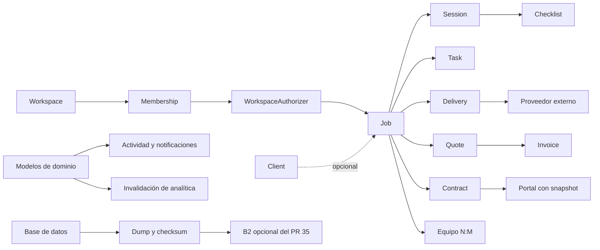

# LumaFlow 2.0 — Auditoría de Fase 0

Fecha: 2026-10-29. Issue: [#36](https://github.com/AVL05/lumaflow-studio/issues/36). Epic: [#37](https://github.com/AVL05/lumaflow-studio/issues/37).

## Dictamen y alcance

La base existente permite una evolución incremental. React 19/JSX/Vite y Laravel 13 deben conservarse. Los módulos comerciales, colaboración y recuperación tienen implementación y pruebas; no procede reconstruirlos. El nuevo núcleo audiovisual todavía no existe como dominio específico.

Snapshot auditado: rama `feat/backup-b2-storage`, HEAD `efd6ef5`; `main` remoto consultado: `03676ea496b22d6538f4c2fcb0671bf6592e64ff`. El PR #35 está abierto: su soporte B2 existe en esta rama, **no se considera publicado**. `test_plan.md` ya estaba sin seguimiento y queda intacto.

Se inventariaron 612 archivos versionados: 179 archivos PHP en `backend/app/`, 25 migraciones, 23 archivos de tests backend, 26 frontend y 11 specs E2E. Es una auditoría estática transversal con ejecución de pruebas, no una certificación completa de seguridad ni de producción. No se inspeccionaron registros, buckets ni secretos reales. No se ejecutaron migraciones productivas.

Método: lectura de README/AGENTS raíz y por stack, documentación de `docs/`, rutas, modelos, requests, resources, servicios y pruebas; búsqueda global de referencias; grafo estático de imports frontend desde `main.jsx` y tests; revisión GitHub de issues/PR y Actions; build y suites. La falta de imports por sí sola no demuestra código PHP muerto: comandos y policies se descubren por convención Laravel.

## Inventario de módulos

KEEP conserva implementación; IMPROVE la amplía; REPLACE sustituye un mecanismo concreto; REMOVE requiere evidencia de inutilidad; DEFER queda fuera del MVP. Un módulo conservado puede tener mejoras pendientes. Las rutas siguientes son relativas a la raíz del repositorio.

| Módulo | Decisión | Estado y evidencia |
| --- | --- | --- |
| Autenticación/cuentas | KEEP | `backend/app/Http/Controllers/Api/Auth/`, Sanctum, verificación, reset; `AuthTest.php`; `frontend/src/features/auth/`. #26 cerrado mediante #33: ya conserva token ante red/5xx. Eliminación integral de cuenta no implementada. |
| Workspaces/colaboración | IMPROVE | `WorkspaceAuthorizer.php`, `WorkspaceService.php`, memberships/invitaciones, policies; `WorkspaceOwnershipTest.php`, `WorkspaceMembershipTest.php`, `WorkspaceInvitationTest.php`. Roles reales owner/admin/member. Sin selector completo ni correo de invitación automático (#25), invited-first (#27), traspaso (#31). |
| Clientes/importación | KEEP | `ClientController.php`, `ClientImportService.php`, `frontend/src/features/clients/`; CSV validado. Dedupe por creador en importación, no por estudio: revisar en colaboración. |
| Trabajos/proyectos | IMPROVE | `Models/Job.php`, `JobController.php`, `JobRequest.php`, `JobWorkflowService.php`, `pages/JobsPage.jsx`, `JobDetailPage.jsx`. Cliente nullable en esquema/request/formulario. Pipeline comercial y tareas ya existen; no crear un segundo Project paralelo. |
| Sesiones | KEEP | `SessionController.php`, `SessionRequest.php`, `features/sessions/`, `SessionCrudTest.php`; fechas, localización, notas y workflow. Tipos actuales centrados en fotografía. |
| Reservas | IMPROVE | `PublicBookingController.php`, `BookingRequestController.php`, `/book/:slug`, `PublicPortalTest.php`; formulario de solicitud y conversión. No equivale a motor completo de disponibilidad/reserva automática. |
| Calendario | KEEP | `CalendarService.php`, `CalendarQueryRequest.php`, `features/calendar/`, `calendarUtils.test.js`; sesiones, tareas, entregas, feed ICS. Rango validado pero sin máximo temporal. Reordenación táctil/teclado debe verificarse. |
| Tareas/checklists | IMPROVE | `TaskController.php`, `ChecklistService.php`, `features/tasks/`, `features/checklists/`, `WorkflowTest.php`; plantillas y orden existentes. Checklist ligado a sesión, sin vínculo directo a proyecto. |
| Equipo/localizaciones/presets | KEEP | `GearItemController.php`, `LocationController.php`, `PresetController.php`, modelos correspondientes, Leaflet y `features/locations/`. Favoritos de equipo/localizaciones son válidos: no son selección de fotografías. |
| Presupuestos/facturas | KEEP | `CommercialDocumentService.php`, Dompdf, `resources/views/pdf/`, `CommercialWorkflowTest.php`. Estados, importes, numeración y PDF activos. Mantener datos y funciones en navegación secundaria. No es certificación fiscal de facturación. |
| Contratos/portal | KEEP | `ContractService.php`, `ContractPortalService.php`, `ContractTest.php`, `ContractPortalTest.php`, `pages/ContractPortalPage.jsx`. Snapshot y aceptación simple; no firma certificada. Espejo `contract_*` de trabajos aún usado: #28, no borrarlo ahora. |
| Entregas externas/portal | IMPROVE | `Delivery.php`, `DeliveryRequest.php`, `PublicDeliveryController.php`, `PublicDeliveryResource.php`, `/deliver/:token`, `e2e/tests/deliveries.spec.js`. Fecha, enlace, proveedor, contraseña, comentario y aprobación existentes. Sin revisiones numeradas, recepción ni historial de comentarios. Cliente todavía obligatorio para Delivery. |
| Hosting de galería/favoritas | REMOVE (restos) | No hay controlador/ruta/modelo de imágenes activo ni carga masiva. Migración `2026_09_16_000001_delivery_external_gallery.php` ya elimina `delivery_images`. Demo actual usa enlaces externos. Persisten afirmaciones/capturas antiguas en marketing y README; corregir con verificación visual, no eliminar funciones activas. |
| PWA | KEEP | `frontend/vite.config.js`, `main.jsx`, `virtual:pwa-register`. Shell offline, no sincronización offline de datos. WebLLM excluido del precache por patrón `lib-*.js`. |
| IA WebGPU/historial | IMPROVE | `features/ai/webGpuAi.js`, `localAiRepository.js`, `localAiSchema.js`, `localAiRepository.test.js`, `ai-history.spec.js`. Carga bajo demanda, streaming real WebGPU, historial IndexedDB por cuenta/estudio. No hay esquema validado para propuestas creativas. |
| Ollama | KEEP | `OllamaService.php`, `AiController.php`, `SessionPlannerService.php`, `config/ollama.php`; compatibilidad opcional. No instalar proceso residente en Render. Persistencia backend legacy activa, no confundir con historial WebGPU. |
| Analytics/notificaciones/búsqueda | KEEP | `AnalyticsService.php`, `AnalyticsCache.php`, observer de invalidación, `NotificationService.php`, `SearchService.php`; caché y límites por grupo. Ingresos actuales se derivan de presupuestos de entregas, no cobros bancarios: no inventar precisión contable. |
| Backups/exportación | IMPROVE | `DataBackupService.php`, `RemoteBackupService.php` (PR #35), comandos, `BackupRestoreTest.php`, `RemoteBackupTest.php`, `docs/backup-recovery.md`. Checksum, retención y drill sintético. #24 sin evidencia de tres días productivos. ExportService solo seis recursos CSV/JSON: no exportación integral de cuenta. |
| Observabilidad | IMPROVE | `Support/AuditLog.php`, `Support/SentryScrubber.php`, `app/sentry.js`, tests de correlación/redacción. Sentry opcional; source maps #29 pendientes. Revisar redacción del canal de logs propio. |
| Donaciones | DEFER → Fase 5 | No `/support`, env de apoyo ni `.github/FUNDING.yml`. Diseño en [donaciones](2026-10-29-lumaflow-2.0-support.md), sin activar cuentas ni enlaces. |
| Briefing/shot list/rodaje/post | DEFER → Fases 2–3 | No modelos, migraciones ni endpoints específicos. `Job.description` y tareas genéricas no equivalen a estos módulos. Reutilizar Job/Task/Checklist. |
| Navegación y marketing | REPLACE (organización/copy) | `components/layout/AppLayout.jsx` prioriza cuatro rutas; tareas/entregas secundarias. `PricingPage.jsx` conserva planes futuros; `PrivacyPage.jsx` dice alojar fotos en S3. Cambios visibles fuera de la limpieza de Fase 0. |

## Dependencias y fronteras que no deben romperse

Las nuevas entidades creativas deben colgar de `photography_jobs` y heredar su workspace. No renombrar la tabla física a `jobs` (reservada para colas Laravel). Mantener `job_id`, `/api/jobs`, IDs, estados y enlaces actuales. `CleansUpWorkflowRelations` depende de eventos Eloquent: no sustituir borrados por query masiva. Los nuevos módulos que alimenten KPIs deberán participar en invalidación solo si cambian esas métricas.

## Hallazgos reproducibles y riesgos

A01–A03 también se reprodujeron localmente con tres probes PHPUnit y diez assertions sobre datos sintéticos; véase [evidencia](2026-10-29-lumaflow-2.0-validation.md). Su resultado PASS confirma el comportamiento observado, no que sea seguro. Permanecen pendientes de corrección en #39.

| ID / prioridad | Evidencia | Consecuencia y acción |
| --- | --- | --- |
| A01 / alta | `JobRequest.php`, `SessionRequest.php`, `DeliveryRequest.php` validan asociaciones con `whereIn(workspaceIds())`, sin igualdad con el workspace del recurso padre; `JobController::store()` toma workspace actual, no el del cliente. | Un miembro de varios estudios puede asociar entidades de estudios distintos. Al cargar relaciones de Job/Delivery no se reaplica el scope del relacionado. Reproducción segura: fixtures de dos estudios y miembro común, asociar cliente B a trabajo A, consultar con miembro solo A. Añadir prueba de rechazo antes de ampliar dominio; no se ha probado contra producción. #39. |
| A02 / alta | `PublicDeliveryController::find()` busca `public_token` sin filtrar estado/caducidad/revocación; `Delivery` guarda token plano; `approve()` y `requestChanges()` actualizan directamente y notifican en cada petición. | Portal sin lifecycle comparable a contratos, con reintentos que repiten notificaciones y comentario sobrescrito. `gallery_expires_at` no controla el token de LumaFlow ni el acceso del proveedor. Diseñar migración compatible, idempotencia y revisión #39/#44. |
| A03 / alta | `AuditLog::apiException()` escribe mensaje y path originales; `mailFailed()` recibe `getMessage()` de la excepción SMTP. `SentryScrubber` protege Sentry pero no este canal. | Canarios sintéticos confirman que mensaje/path llegan sin redacción al logger; no se ha comprobado fuga de datos reales. Sanear antes de emitir. Nunca publicar payloads sensibles. #39. |
| A04 / alta operativa | #24 abierto; #35 abierto; Actions recientes de `Production backup` en `03676ea` están `skipped`; documentación dice no activado. | Implementación/drill sintético no prueban backup real recuperable. No borrar columnas/archivos/datos sin copia y restore aislado autorizado. |
| A05 / media | `BelongsToWorkspace::scopeAccessibleBy()` abarca todas las memberships; `AnalyticsCache::scopeIds()` usa conjunto de estudios. `current_workspace_id` orienta creación, no todas las lecturas. `AiContextService` e importación usan relaciones por creador. | Aislamiento ante ajenos existe, pero selección actual y contexto IA no son uniformes. No presentar listas/IA como restringidas siempre al estudio seleccionado. Definir alcance explícito y probar antes de cambiar semántica. #39/#40/#46. |
| A06 / media | `JobController::index()` termina en `get()`; `loadJob()` carga todas las relaciones; `ExportService::export()` materializa `get()->map()->all()` antes del stream. | Consumo potencial sin cota; no es una medición de saturación. Paginar Jobs requiere coordinar `api/jobs.js` y `JobsPage.jsx`, no es limpieza compatible. Exportar con cursor/lotes en issue propio si medición lo justifica. |
| A07 / media | `JobsPage.jsx` solicita 100 clientes; `ClientController` limita a 48 por página. | El selector inicial muestra como máximo 48 sin buscar siguientes páginas. Reutilizar búsqueda/paginación; fixture de más de 48 clientes en #40. |
| A08 / media | `runWebGpuJson()` solo hace `JSON.parse`; esquema es texto en prompt. `SessionPlannerService::plan()` persiste resultado Ollama inmediatamente. | JSON válido no garantiza esquema ni referencias válidas. Antes de nuevos efectos: validación determinista y propuesta editable con confirmación. #46. |
| A09 / media | `HealthService::summary()` prueba escritura/lectura/borrado de storage y caché cada vez; `render.yaml` usa `/api/health` y `FILESYSTEM_DISK=s3`. | Sonda pública sin throttle específico puede consumir llamadas S3 y CPU; docs dicen no depender de S3. Medir y separar health/readiness sin debilitar monitorización, en #48. No cambiar configuración productiva ahora. |
| A10 / media | `AuthController` no tiene eliminación de cuenta; `ExportService::COLUMNS` solo sesiones/clientes/entregas/tareas/equipo/localizaciones; FKs `user_id` tienen cascadas. | Exportación/retirada integral y conservación comercial/colaborativa necesitan diseño. Borrado de owner podría afectar recursos de otros miembros si se añade ingenuamente; depende de #31. #48. |
| A11 / baja | `JobWorkflowService::seedTasks()` fija fechas relativas a evento incluso para edición/entrega. | No reutilizar ese cálculo como cronograma audiovisual fiable. Proponer fechas explícitas y orientativas, confirmar antes de guardar. #43/#46. |

### Documentación frente a código

- README dice favoritas/galería propia y «invitaciones por email»; demo real ya muestra entrega externa y las invitaciones requieren compartir token (#25).
- `PrivacyPage.jsx` describe fotos subidas a S3, aunque no hay endpoint de subida. `PricingPage.jsx`, README y roadmap contemplan planes futuros; contradicen la decisión gratuita 2.0.
- `docs/database.md` conserva párrafo duplicado de numeración y explicación de ownership de #4 anterior a memberships #5. El comentario del trait también está desactualizado.
- `docs/api.md` promete paginación de todos los listados; Jobs y checklists no la implementan. La sección de contratos dice portal futuro #8 aunque lo documenta después como implementado.
- `docs/architecture.md` dice que no hay streaming IA: debe distinguir streaming real WebGPU de `streamingAvailable()` legacy Ollama sin transporte SSE. También generaliza tokens hasheados/caducables a portales con mecanismos diferentes.
- `docs/deployment.md` dice «no se requiere S3», pero `render.yaml` sí lo configura para el disk funcional y la sonda. B2 usa un disk independiente en #35.
- `frontend/README.md` y `backend/README.md` siguen siendo plantillas de Vite/Laravel. No son fuente fiable del producto; sustituir por enlaces y comandos reales.

Estas contradicciones son hallazgos, no cambios de comportamiento autorizados en esta fase. Corregir README y referencias documentales mínimas ahora; el copy público requiere #38/#45/#47 con tests y capturas. No modificar afirmaciones legales silenciosamente.

## Código, dependencias y assets

Retirada segura seleccionada tras inventario:

| Archivo | Evidencia antes de borrar | Alcance de validación |
| --- | --- | --- |
| `frontend/src/features/ai/ScoreBadge.jsx` | Única aparición de `ScoreBadge` es su definición; ningún import estático/dinámico ni export de barril lo alcanza desde entrada o tests. | Vitest, lint y build después de retirarlo; no eliminar tests ni añadir un test que solo compruebe ausencia del archivo. |
| `backend/app/Http/Requests/TagRequest.php` | Única referencia de clase es su definición; no hay ruta/controlador/modelo Tag ni tabla `tags` en migraciones. Los tags de Location son JSON independiente con validación en `LocationRequest.php`. FormRequest no es policy/comando autodescubierto. | PHPUnit y Pint; rutas y API intactas. |

No hay dependencia runtime demostrablemente sobrante. React/DOM/router/Axios son base; Leaflet localizaciones; Recharts analítica; WebLLM IA; Sentry observabilidad. `workbox-window` lo consume el módulo virtual `virtual:pwa-register`, aunque no aparezca como import literal en src. Dompdf genera PDFs. `league/flysystem-aws-s3-v3` sostiene `RemoteBackupService` y el disk S3 de health: **KEEP**. Faker/Mockery/PHPUnit y Testing Library/fake-indexeddb/Playwright sostienen pruebas; tipos React son herramientas de desarrollo, no una migración TS que retirar automáticamente. Tinker/Pail/Pao no se eliminan por no tener imports: son herramientas/framework.

### Auditorías de seguridad de dependencias

Ejecutadas el 29-10-2026, ambas con exit 1 por advisories: `pnpm audit --prod --json` y `composer audit --locked --format=json`. No se actualizó ningún lockfile. Mantener una dependencia útil no significa que su versión bloqueada sea segura. Trabajo específico: [#49](https://github.com/AVL05/lumaflow-studio/issues/49), prioritario antes de release.

| Paquete bloqueado | Avisos reportados | Evaluación inicial |
| --- | --- | --- |
| Axios 1.19.0 y follow-redirects 1.16.0 | 14 total: 9 high, 5 moderate | Uso SPA, no servidor Node del producto. Varios avisos afectan adaptadores Node/HTTP2/proxy; otros requieren contaminación previa o configuración particular. Triar por ruta real, no asumir 14 exploits alcanzables. El [advisory de fetch/maxRedirects](https://github.com/advisories/GHSA-r4gj-5m52-g5wh) fija condiciones concretas y versión corregida; revisar actualización compatible y transitiva. |
| dompdf/dompdf v3.1.5 | 6: 4 medium, 2 low | Revisar aislamiento de recursos/imágenes y plantillas PDF controladas; no recibe una galería de usuario. Mantener PDF y actualizar de forma enfocada. |
| laravel/framework v13.19.0 | 3: 1 critical, 1 medium, 1 low | El [crítico TokenGuard](https://github.com/advisories/GHSA-f9x3-7vq9-cph6) afecta ese guard específico. El código usa `auth:sanctum` y guard web de sesión, no TokenGuard configurado: no se afirma bypass de Sanctum. Sigue pendiente revisar/actualizar versión compatible. |
| league/commonmark 2.8.2 | 12: 9 high, 3 medium | Revisar extensiones Markdown realmente habilitadas y correo/documentos; el número del scanner no demuestra que todas las extensiones sean alcanzables. |
| league/flysystem 3.35.2 | 1 low | Revisar normalización de rutas y defensa de nombres de backup; no retirar el adaptador que sostiene recuperación. |
| symfony/http-foundation v8.1.1 | 1 high | [CVE-2026-108082](https://symfony.com/cve-2026-108082): versión bloqueada incluida en rango afectado; revisar parche compatible y alcance en peticiones HTTP. No lanzar payload de saturación contra producción. |
| symfony/mime v8.1.0 | 1 medium | [CVE-2026-45070](https://symfony.com/cve-2026-45070): revisar inputs de correo y parche compatible. |

Composer suma **24 advisories en seis paquetes de producción** (1 critical, 10 high, 9 medium, 4 low), sin paquetes abandonados reportados. Son avisos de catálogo, no incidentes observados. Las actualizaciones requieren pruebas de PDF, auth, correo, frontend y backup, no `audit --fix` automático durante una limpieza. No se ejecutó auditoría npm de devDependencies: el comando fue `--prod`.

`useResource` y `usePaginatedResource` resuelven cargas diferentes; no se ha demostrado duplicación que justifique fusionarlos. Scopes `ownedBy` legacy y espejos `contract_*` tienen compatibilidad activa o pendiente #28. Conservar migraciones históricas, incluso la de retirada de imágenes: editarlas no recuperaría material antiguo.

Las capturas de `docs/screenshots/` y `frontend/public/product/` cumplen funciones documentales y de marketing. Que compartan bytes no demuestra redundancia segura. `deliveries.png` no tiene referencia textual pero es documentación útil; no borrar por esa única razón. `gallery.png` sigue enlazada en README/marketing: revisar visualmente antes de sustituirla. Logos (~1,62 y ~1,60 MB) son assets reales, no temporales: optimización medida futura, no borrado.

No se encontraron archivos versionados `.mp4/.mov/.raw/.nef/.cr3/.psd/.zip`; el mayor archivo versionado es un logo de 1.620.925 bytes. Esto no demuestra que no existan objetos históricos en storage productivo.

## Consumo y eficiencia

| Recurso | Consumidor real | Decisión |
| --- | --- | --- |
| Base de datos | Dominio, actividad/notificaciones, Sanctum, IA legacy, colas opcionales; agregaciones Analytics con caché de 300 s | Conservar; medir consultas/listados grandes. Nuevas tomas/notas son texto acotado y paginado, no binarios. |
| CPU/memoria API | Dompdf, exportación materializada, eager loads de detalle, dumps comprimidos; Ollama solo si se configura | No quitar documentos/backup; acotar export/detalles por medición. No instalar inferencia en Render. |
| Almacenamiento | DB; staging de backups; B2 opcional; logs/cache efímeros; historial y pesos de modelo en navegador | Separar copia de negocio, secretos APP_KEY y contenido local. Backups no incluyen IndexedDB ni fotografías externas. |
| Red externa | SMTP, Sentry opcional, tiles OpenStreetMap, descarga de pesos WebLLM, proveedor de entrega; S3/B2 según entorno | No proxy/copiar medios, no SDK de donación. Revisar términos/privacidad del proveedor y carga de mapas bajo demanda. |
| Frontend | Build: entry 688,00 kB / gzip 197,52 kB; WebLLM 6.025,98 kB / gzip 2.163,71 kB; precache 23 entradas / 1.433,47 KiB | Es tamaño de build, no tiempo de carga ni Core Web Vitals. Mantener chunk IA diferido; entry y precache merecen presupuesto y medición de red. |

## Infraestructura: revisión documental vigente

Fuentes consultadas el 29-10-2026; cuotas de la cuenta real y configuración efectiva no inspeccionadas. No se modificó ningún despliegue.

- [Vercel Hobby](https://vercel.com/docs/plans/hobby) restringe uso a personal no comercial. Las [Fair Use Guidelines](https://vercel.com/docs/limits/fair-use-guidelines) **excluyen expresamente pedir donaciones del uso comercial**. Eso permite diseñar apoyo voluntario, pero no certifica la elegibilidad de toda una plataforma pública para profesionales. Solicitar aclaración al proveedor si el uso completo no encaja; no contratar ni migrar automáticamente.
- [Render Free](https://render.com/docs/free): suspende tras 15 minutos sin tráfico; arranque aproximado de un minuto y filesystem efímero; 750 horas gratuitas compartidas por workspace/mes, suspensión al agotarlas. El proveedor desaconseja Free para producción. Mantener beta con límites explícitos, no prometer disponibilidad profesional; no eludir suspensión con pings ni cron continuo.
- [TiDB Starter FAQ](https://docs.pingcap.com/tidbcloud/serverless-faqs/): cada una de hasta cinco instancias elegibles tiene 5 GiB row + 5 GiB columnar y 50 millones RU/mes. Con cuota gratuita agotada y sin límite de gasto positivo se restringen operaciones. Es cuota por instancia, no 25 GiB para una sola. Mantener gasto cero; verificar en consola antes de activar cargas nuevas.
- GitHub Actions ya prepara ejecución diaria de backup (gated), no hace falta `schedule:run` cada minuto. En [eventos schedule](https://docs.github.com/en/actions/reference/workflows-and-actions/events-that-trigger-workflows#schedule) existen retrasos y desactivación por inactividad; no es SLA. No confundir workflow instalado con backup efectivo.
- B2 de #35 aún exige cuenta/bucket/key y comprobación de cuotas del operador según `docs/backup-recovery.md`; no se provisionó ni activó durante esta auditoría.

## GitHub y despliegues

Se leyeron los cuerpos disponibles de los 20 issues y 15 PR anteriores a esta tarea mediante conector GitHub. La búsqueda del conector devolvió estado nulo; se verificó estado real mediante `gh issue list` / `gh pr list`.

- Abiertos existentes: #24 backups, #25 correo invitaciones, #27 onboarding invitados, #28 espejo contractual, #29 source maps, #30 móvil, #31 transferencia owner. No duplicar.
- #1, #3–#13 y #26 cerrados. PR #2, #14–#23, #32–#34 mergeados. PR #35 abierto para la rama actual; no adjuntar allí cambios 2.0 ni afirmar que B2 está en main.
- Actions recientes consultadas en `03676ea`: smoke productivo `success` y backup `skipped`. Un smoke HTTP no es prueba visual, de roles, accesibilidad, recuperación o del código local nuevo.
- Backlog nuevo #36–#49: [plan e issues](2026-10-29-lumaflow-2.0-plan.md). Issues de seguridad publicados como objetivos de cobertura sin datos reales ni payloads explotables.

## Resultado y siguiente decisión

La primera entrega es auditoría/plan y dos eliminaciones sin comportamiento. No desarrolla la versión 2.0 completa. Antes del workspace creativo: reforzar coherencia de asociaciones, privacidad de logs y lifecycle público; resolver evidencia de recuperación #24 y revisión separada #35. El sprint recomendado y la migración expandir/verificar/retirar están en el [plan](2026-10-29-lumaflow-2.0-plan.md).

Pruebas, comandos, límites del entorno y comprobaciones después de la limpieza: [validación](2026-10-29-lumaflow-2.0-validation.md). Donaciones y cuestiones legales/fiscales a revisar: [diseño de apoyo](2026-10-29-lumaflow-2.0-support.md).
